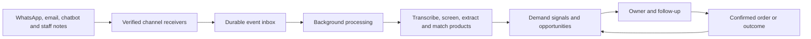

# Connecting GhostDemand to a real business

Implementation blueprint, 28 October 2026. This document describes the next
integration work; it does not mean accounts have been connected or the local app
has been deployed publicly.

The aim is automatic capture from the tools the business already uses, with a
short review queue for exceptions and a quick staff fallback for offline
requests. Start with one business and a few channels, then expand after checking
capture quality and reliability.

## The five-channel business in this discussion

The assumed business uses **WhatsApp, email, a website chatbot, sales notes and
voice notes**. Keep these tools in place and connect their events to GhostDemand.

| Channel | Connection approach | What staff experience |
| --- | --- | --- |
| WhatsApp | Authorized business messaging webhook, with message and conversation IDs. | Staff continue using the business inbox; relevant requests appear in GhostDemand. |
| Email | Authorized business-mailbox connector; fetch new messages and thread context. | Staff continue handling email normally; copied thread history is not counted as new demand. |
| Website chatbot | A server-side conversation/event callback from the existing chatbot. | An unresolved conversation can become a request without retyping it. |
| Sales notes | The existing mobile-friendly capture form, or a button in the business's current sales tool. | A salesperson records a short note and confirms the extracted details. |
| Voice notes | A backend media/transcription worker for uploaded or WhatsApp audio; retain the original audio reference. | Staff record or receive a note; a transcript becomes a reviewable draft. |

For Gmail, use the [Gmail API push notification flow](https://developers.google.com/workspace/gmail/api/guides/push)
through Cloud Pub/Sub. Notifications identify mailbox changes; the worker must
fetch the affected messages. Renew the mailbox watch and reconcile missed changes.
For Microsoft 365, use [Microsoft Graph Outlook change notifications](https://learn.microsoft.com/en-us/graph/outlook-change-notifications-overview),
including subscription renewal and lifecycle recovery. Other mail providers need
their supported mailbox API or an authenticated inbound-mail service.

**Email is not yet a supported source in the app's channel enumeration.** Add the
email source, provider adapter, thread IDs and body-cleaning rules before connecting
a mailbox. Keep customer text separate from signatures, quoted history and the
business's own replies, while preserving the original evidence for context.
Similarly, the current browser dictation control is not a backend audio-upload or
WhatsApp audio-transcription service; that worker and media flow must be built.

## The operating flow

Store the incoming event before acknowledging receipt. A worker processes it
later, so a model timeout does not lose the customer request. Record whether the
event was processed, ignored, needs review or failed. Retry failures and provide
an operator-visible way to replay them.

## Channel connections

| Source | How to connect | What should become demand evidence | Existing app support / remaining work |
| --- | --- | --- | --- |
| WhatsApp | Use a business messaging provider such as Twilio; configure a public HTTPS inbound webhook. | Relevant customer requests and explicit inability to fulfil them, with conversation context. | The form receiver accepts Body, From and MessageSid. Add signature verification, conversation grouping, media handling and eligibility screening. Direct Meta Cloud API payloads need a separate adapter. |
| Email | Authorize the business mailbox and subscribe to new-message changes. | A buying request, its thread context and a supported unmet/unresolved outcome. | Add the email source, mailbox adapter, message/thread IDs and quote/signature cleanup; no mailbox is connected today. |
| Website search | Instrument the site's actual search-result response, or its server-side search endpoint, and forward a zero-result event. | A failed query, its filters, result count and product/variant context. | `/api/events/website-search` handles zero-result queries. Add a store adapter and result/filter context. Do not put private integration keys in storefront JavaScript. |
| Product pages / unavailable variants | Capture a deliberate unavailable-item request, such as a notify-me submission or a failed add-to-cart caused by stock. | An explicit interest event tied to an exact SKU and variant. | Generic signal and stockout-request APIs exist. Add platform-specific event capture and catalog synchronization. |
| Inventory / POS | Connect catalog and availability APIs; subscribe to relevant stock changes where supported. | Stock availability as context; staff can record a customer request that could not be served. | Product aliases are not a live inventory connection. A stock balance of zero alone is not evidence that a customer requested the product. |
| Salespeople | Keep a short mobile capture form or a button in the existing POS/CRM; allow typed notes and supported voice dictation. | A missed request with product, quantity and blocker confirmed by staff. | Text capture and browser dictation exist. Provider voice notes need secure media retrieval and transcription before text processing. |
| Chatbot | Forward unresolved conversations or explicit unavailable-product events through the chatbot's backend. | A customer intent that remained unfulfilled, rather than every message in the conversation. | `/api/signals` accepts chatbot text. Add the vendor connector, conversation IDs and resolution signals. |
| Quotes | Subscribe to CRM/quotation status changes and include quote line items. | An explicitly declined quote and its recorded reason. | The source label exists. Add CRM/ERP integration; distinguish declined, expired and still-open quotations. |
| Abandoned enquiries / carts | Define an inactivity rule with the business and check for later continuation or purchase. | An unfinished enquiry, labeled as observed abandonment rather than a proven lost sale. | Manual capture exists. Add platform event capture, scheduled checks and cancellation/reconciliation when the customer returns. |

Twilio supports configurable inbound WhatsApp webhooks and supplies message text,
media references and unique message IDs. Its SDK validation should be used for
request signatures. See the official [WhatsApp overview](https://www.twilio.com/docs/whatsapp/api)
and [webhook security guidance](https://www.twilio.com/docs/usage/webhooks/webhooks-security).
A body-only receiver does not process an incoming audio note automatically.

Shopify provides signed webhook deliveries, delivery identifiers and resource
subscriptions. A storefront search still needs instrumentation where no suitable
platform event supplies the query/result evidence. Follow the official
[delivery verification](https://shopify.dev/docs/apps/build/webhooks/verify-deliveries)
and [webhook overview](https://shopify.dev/docs/apps/build/webhooks). Delivery may
be duplicated, arrive out of order or be missed; retain provider timestamps and
reconcile with the platform's API instead of relying only on webhooks.

## Make capture accurate before making it automatic

The current WhatsApp endpoint logs any non-empty text. Before a pilot, add a
screening stage that decides whether the event contains an actual request and
whether that request appears unfulfilled. A greeting, thank-you, routine order
update or successfully answered question should not be forced into one of the
six lost-sale reasons. Use an explicit unknown/review path when evidence is weak.

Track request fulfilment separately from staff follow-up status. A new question
can be pending; a business reply or order can establish that it was fulfilled;
an explicit inability to supply can establish unmet demand. Inactivity can indicate
an unresolved enquiry under an agreed business rule, rather than a proven loss.
These fulfilment-state fields and conversation-resolution rules are proposed
extensions; the existing open/following-up/recovered/closed status tracks staff work.

Normalize product names against the retailer's catalog while retaining exact
variants, sizes and units. Split multi-product enquiries into line items. Match
related messages to the same enquiry so a customer sending three messages does
not automatically become three missed sales. Treat provider retry deduplication
and enquiry-level grouping as separate problems.

Store observed facts separately from estimates: requested quantity versus a
default, total budget versus unit price, confirmed stock versus assumed
availability, and recorded outcome versus predicted recovery. Keep currency
attached to each amount. Do not label all zero-result searches as products the
business never stocks; naming, filters or search relevance may be responsible.

## Reliability and production work

1. **Deploy a managed HTTPS service.** Run Flask behind a production WSGI server
   such as Gunicorn, with a domain, stable configuration and health checks. The
   current local development server is not the production deployment. See
   [Flask's deployment guidance](https://flask.palletsprojects.com/en/stable/deploying/).
2. **Add a durable event inbox and asynchronous workers.** A practical candidate
   is RQ with Redis, plus a persistent database inbox as the source of truth.
   Commit the raw event first, acknowledge quickly, then enqueue processing.
   Use an outbox/dispatcher so a database commit followed by queue failure is
   recoverable. RQ documents [background jobs](https://python-rq.org/docs/) and
   [retries / failed-job handling](https://python-rq.org/docs/exceptions/).
3. **Use business-scoped identities and storage.** For a real multi-business
   service, introduce PostgreSQL with proper migrations, business/workspace IDs,
   authenticated users and role-based access. Scope events, catalog items,
   customer references, signals, outcomes and model artifacts by business.
   Derive business identity from an authenticated connector, not an arbitrary
   browser field. Changing the SQLite filename alone is not a PostgreSQL migration.
4. **Secure each receiver.** Verify provider signatures, authenticate internal
   APIs, store credentials on the server, limit request sizes/rates and use
   appropriate access and retention rules for customer records. Provide recording
   notices/permission where voice capture is used.
5. **Make retries safe.** Persist a unique key such as business + connector +
   provider event ID. Retried processing must not create another signal or order
   outcome. The prototype's source/external-ID deduplication is a useful start,
   but it is not a complete multi-business event or conversation identity scheme.
6. **Make failures visible.** Show each connector's last successful event,
   processing lag, received/processed/ignored/failed counts and backlog. Alert an
   operator on sustained failure and offer controlled replay. Regularly compare
   with provider records and restore-test backups.

## Keep the daily experience simple

A business owner connects its channels once, maps its product catalog and sets
routing rules such as branch, product category and default owner. Staff then work
in Opportunities, Signal inbox and Follow-up queue. Notifications should link to
an actionable request, rather than reporting every incoming event.

During the pilot, review uncertain, incomplete or potentially duplicate signals.
Automate clean cases only after measuring accuracy on representative business
requests. Preserve the original evidence so a staff member can correct a field
without retyping the conversation. Model training, evaluation, versioning and
rollback stay in the backend.

Keep observation and action separate. An opportunity may suggest a restock or
follow-up, but it should not silently purchase inventory or message customers.
Messaging automation would be a separate configured workflow.

## Close the loop with real orders

Connect order/completion events from the store, POS or CRM. Match a later order
to the relevant request using customer reference, product/variant and an agreed
observation window. Ask for review when the match is ambiguous. Record the order
ID and actual completed value, considering cancellations and returns. A later
purchase should not automatically be credited to GhostDemand without evidence.

The current follow-up queue records outcomes manually. Automatic order matching
is a proposed integration, not an existing connection. Model recovery training
also needs verified outcomes; open enquiries are not automatically negative labels.

## Recommended first pilot

Use one retailer and one branch. Start with **WhatsApp, email and the existing
staff sales-note form**, then add the chatbot callback and backend voice-note
processing. Import or synchronize its catalog so every
signal can reference a real product or a reviewed new-product request. Connect
orders before claiming recovered sales.

Test these situations before expanding: a duplicate delivery, a temporary outage,
an audio-only message, a greeting, a successfully resolved enquiry, a multi-item
request, a failed query caused by a filter, and a later order/cancellation.
Measure capture coverage against known provider events, field accuracy on a
reviewed sample, duplicate rate, processing delay and the share of open requests
with an owner and next step. Set acceptance targets with the pilot business and
report observed results rather than promising complete capture.

The exact connector work depends on the tools the business already uses. No
live account connections or public deployment have been performed by this plan.
