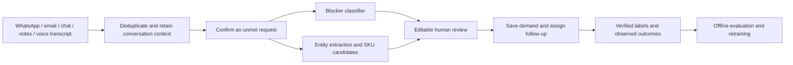

# Build GhostDemand's ML backend, one experiment at a time

This is a guided code workspace for learning **EDA → preparation → splitting →
training → evaluation → saving → deployment → monitoring**. It does not switch
the running app to a new model. Commands below run from the GhostDemand project
root; the code is organized so you can open each lesson and follow its functions.

Start with blocker classification. It is a small, complete supervised-learning
problem connected to the existing app. Then learn retrieval with product
matching. Use [ADVANCED.md](ADVANCED.md) for entity extraction, recovery and
forecasting after collecting their different target datasets.

## 0. Understand the jobs before choosing models

| Business job | Model to learn | Input → output | Training data |
|---|---|---|---|
| Explain why a request failed | Character TF-IDF + logistic regression; compare SetFit/MiniLM | Confirmed unmet request context → six blocker scores | Reviewed request/reason pairs |
| Find the intended product | TF-IDF cosine baseline; compare MiniLM embeddings, optionally fine-tuned | Product wording → ranked SKU candidates | Catalog + query/product relevance judgments |
| Extract request details | DistilBERT token classifier | Text → product/quantity/budget/currency/location spans | Retail field annotations |
| Prioritize follow-up | CatBoostClassifier | Capture-time request features → 14-day conversion score | Mature verified conversion outcomes |
| Plan stock using completed sales | LightGBM regressor | Lagged SKU/week sales → next-week sales | Dated completed transactions |

A blocker model should run **after** determining that a request is unmet. It
cannot decide eligibility with six loss-only labels: it will assign some blocker
even to a greeting or a fulfilled order. For the first pilot, a person confirms
eligibility. Later, label and evaluate a separate eligibility classifier with
`confirmed_unmet`, `pending`, `fulfilled`, `not_a_request`; do not infer those
labels from the model's own predictions.



Voice transcription, channel webhooks, event delivery and inventory checks are
separate system components. See [BUSINESS_INTEGRATION.md](../BUSINESS_INTEGRATION.md).

## 1. Set up a learning environment

Open a terminal at the project root:

```sh
cd /Users/dengachiek/Downloads/GhostDemand
source .venv/bin/activate
python -m pip install -r ml_workflow/requirements.txt
```

The small lessons were run with the existing Python 3.14.8 / scikit-learn 1.9.1
environment. They use standard-library CSV/JSON plus sklearn; pandas and a GPU
are not needed. If you do not have the project environment, create a virtualenv
first with `python3 -m venv .venv`.

Use a **separate Python 3.11/3.12 environment** for the optional transformer and
tabular recipes; check dependency wheel support on your machine. Their dependency
ranges are starting requirements, not a tested lockfile. After a successful run,
save exact packages with `python -m pip freeze > ml_workflow/work/environment.txt`.
Do not install large optional packages into the running app just to read a lesson.

All generated data, models and private exports go under ignored
`ml_workflow/work/`. Public fixture CSVs and blank schemas are in `data/`.
Use [DATASETS.md](DATASETS.md) for the source links and precise limitations.

## 2. Define the target and prepare a practice dataset

Open [prepare_data.py](prepare_data.py) and [common.py](common.py).

```sh
python -m ml_workflow.prepare_data
```

Input: existing `training_data.json`. Output: `work/data/reasons.csv` and a
manifest. Each row represents **one labeled request context**, not an individual
word or a customer's entire lifetime. The starter is explicitly synthetic.

The six target labels mean:

| Label | Evidence required | Example |
|---|---|---|
| `out_of_stock` | The retailer carries it, but inventory is exhausted | “Requested shoes are sold out.” |
| `not_stocked` | The retailer does not carry that item/range | “We do not sell that phone model.” |
| `price_too_high` | Customer cannot accept the price | “The headphones exceed their budget.” |
| `quote_rejected` | A quote was explicitly declined/lost | “They rejected our quotation and chose another supplier.” |
| `lead_time` | Required timing cannot be met | “Delivery arrives after their deadline.” |
| `abandoned` | A documented response/inactivity window elapsed | “No reply after the agreed follow-up window.” |

If several reasons apply, define an annotation policy: record the customer's
explicit primary blocker, send unresolved ties for review, and record secondary
reasons separately if needed. Do not quietly choose whatever the current model
predicts. A request for a discount does not always prove a lost sale.

For real data, fill `data/reasons_template.csv`. Required columns are `id`,
`text`, `reason`, `source`, `conversation_id`, `group_id`, `captured_at`,
`origin`, `is_synthetic` (0/1), and `verified` (1 after review). Use dates such as
`2026-10-28T09:00:00+03:00`. Features must contain only information available
when predicting; exclude final resolution, reviewer labels and later replies.

## 3. EDA: understand the data before fitting anything

Open [eda.py](eda.py), then run:

```sh
python -m ml_workflow.eda
```

Read `work/reports/eda.md` and `eda.json`. Answer these questions:

1. **Grain/count:** Is each row one request? Are several messages the same case?
2. **Missingness:** Are text, labels, dates and grouping IDs populated?
3. **Distribution:** Are all six labels represented? Which channels/languages
   are missing? Perfect synthetic balance does not establish real coverage.
4. **Duplicates/conflicts:** Does repeated text have conflicting labels? Keep
   copies together or deduplicate after resolving annotations.
5. **Text shape:** Are messages very short/long, or unlike actual customer text?
6. **Leakage:** Could paraphrases, the same customer or a future reply cross
   evaluation partitions? Inspect the near-duplicate candidate IDs in JSON.

The supplied run finds 108 synthetic rows, 18 per label, no exact duplicate
texts, no capture dates, and two possible paraphrase pairs. Inspect those pairs
and assign shared `group_id` values if they come from one case/template. The
nearest-neighbor screen is a clue, not a proof of duplication. EDA fits features
only for inspection; those features are discarded before model training.

Cleaning decisions should follow the checks. Preserve negation (“not”), quantities,
brands and size codes. Do not remove all numbers, blindly drop incomplete real
cases, or turn unknown labels into a common class. `validate_reasons()` rejects
empty text, invalid labels, unverified data and conflicting normalized labels.

## 4. Freeze train, validation and test partitions

Open [split_data.py](split_data.py).

```sh
python -m ml_workflow.split_data
```

Output: `work/splits/train.csv`, `validation.csv`, `test.csv`, `manifest.json`.
The starter run gives **66/21/21 rows**, approximately 60/20/20.

- **Train** learns vocabulary and weights.
- **Validation** chooses model settings and an abstention threshold.
- **Test** estimates final quality after those choices are frozen.

The splitter links conversations, supplied customer/template groups and identical
normalized text transitively, deduplicates exact text after linking, and assigns
whole groups using stratified group folds. Every reason must appear in every
partition; if that is impossible, collect more independent examples. Seed 42
and hashes make the partition reproducible. Unknown template families remain a
limitation; the script cannot discover every paraphrase automatically.

With real dates, also run a later-period check:

```sh
python -m ml_workflow.split_data \
  --data ml_workflow/work/business/reviewed.csv \
  --out ml_workflow/work/time-splits --chronological
```

This refuses missing/naive dates, unresolved grouping placeholders and
conversations spanning time boundaries. Choose cutoffs and purge spanning groups
before rerunning. Never randomly mix earlier and later rows for a claim about
future deployment. Keep the real test set separate from synthetic development.

## 5. Train the small baseline and understand what it learns

Open [train_reason.py](train_reason.py) and [evaluation.py](evaluation.py).

```sh
python -m ml_workflow.train_reason
```

The important sequence is:

```python
vectorizer.fit_transform(training_texts)  # Learn vocabulary/IDF from TRAIN only
vectorizer.transform(validation_texts)   # Apply those same learned features
model.fit(training_features, training_labels)
model.predict_proba(validation_features)
```

**Character TF-IDF** represents pieces of words such as `stock` and `expens`.
Term frequency measures presence/frequency; inverse document frequency reduces
the weight of fragments that appear everywhere. Character 3–5 grams help with
short text and spelling variation. Features are normalized per message.

**Logistic regression** learns a weight for each fragment/class. A weighted sum
and intercept produce class scores; softmax converts them into six values that
sum to one. Training minimizes classification loss with regularization. It does
not learn from unreviewed dashboard predictions.

The script compares `C = 0.5, 2, 8` on validation macro F1. `C` controls how
strongly weights are regularized; smaller values generally constrain them more.
`class_weight="balanced"` adjusts unequal class contributions. The first best
validation setting wins ties; the test set is not consulted to select settings.

A majority-class dummy baseline is recorded. A useful candidate should beat
simple alternatives on representative data, not just produce impressive output.

## 6. Evaluate, inspect errors and choose when to defer

Read `work/baseline/evaluation.md`, `evaluation.json` and `test_predictions.csv`.

| Metric | What you learn |
|---|---|
| Accuracy | Fraction of all requests classified correctly |
| Per-class precision | Of predictions for a blocker, how many were correct? |
| Per-class recall | Of true cases of a blocker, how many were found? |
| Macro F1 | Average class F1; makes errors on smaller classes visible |
| Confusion matrix | Which blockers get mistaken for one another? |
| Coverage | Fraction accepted above the chosen score threshold |
| Accepted accuracy | Accuracy only among accepted cases; always show its sample size |
| Log loss | How costly confident wrong probability predictions are |

Scores are **uncalibrated**. A score of 0.8 is not evidence of 80% real-world
correctness. The validation threshold grid searches for the most coverage with
at least five accepted examples and observed accepted accuracy ≥90%. This is a
teaching policy, not a guaranteed business service level. On this tiny dataset
none qualifies, so the saved threshold is **1.0: defer all cases**.

In the supplied synthetic run, test macro F1 is about **0.808** on 21 examples.
That does not justify replacing the active app. Add independently reviewed real
cases, inspect label confusion, and evaluate calibration on additional held-out
data. Do not lower the threshold merely to make the demo look confident.

Join prediction IDs back to the **local** test CSV to inspect errors. Categorize
them: ambiguous context, labeling mistake, new vocabulary, wrong channel,
multiple products, missing language coverage. Correct the dataset policy or add
training examples, tune using validation, and reserve a fresh test set if you
have repeatedly inspected the old one.

## 7. Save and reload the exact candidate you evaluated

Training writes `work/baseline/reason_classifier.json` and `serving.json`.
The JSON contains vocabulary, IDF, numeric weights, labels and provenance. It
matches the existing `demand_ml.ReasonClassifier` format; it is not a pickle.

The saved candidate is fit on **training rows only**. Unlike the app's older
one-command development trainer, this lesson never refits held-out examples
into the candidate after reporting scores. Export validation checks ensure
the saved model reproduces sklearn predictions/scores after reloading.

```sh
python -m ml_workflow.smoke_test
```

The local Flask test client checks loading, valid prediction and bad inputs.
It does not open the application database or change the running model. Check
the training/test hashes, package versions and seed in `evaluation.json`.

## 8. Compare a transformer candidate: SetFit + MiniLM

Read [train_setfit.py](train_setfit.py). This is an optional, heavier experiment;
the starter deliverable does not download transformer weights or train it.

```sh
python3.12 -m venv .venv-ml
source .venv-ml/bin/activate
python -m pip install -r ml_workflow/requirements-transformers.txt
python -m ml_workflow.train_setfit
```

[SetFit](https://huggingface.co/docs/setfit/en/quickstart) fine-tunes sentence
embeddings and trains a classification head. We initialize it with
[`sentence-transformers/all-MiniLM-L6-v2`](https://huggingface.co/sentence-transformers/all-MiniLM-L6-v2),
an English embedding checkpoint; it is not already trained on the six blockers.
The script uses one epoch and small batches as an initial experiment. It trains
only on the frozen training CSV, chooses its score threshold on validation,
and evaluates the same test CSV as the baseline.

Use `--revision HUB_COMMIT_HASH` to pin a reviewed checkpoint revision. Record
the resolved version and package lockfile. GPU/MPS support and speed depend on
the environment; the script does not promise a particular runtime.

Compare both `evaluation.json` files on macro F1, per-class errors, real/channel
slices, accepted accuracy/coverage, latency and memory. Keep the simpler model
unless the measured tradeoff supports the transformer. Never infer an accuracy
improvement from the model's name. The service loads SetFit through a separate
adapter; do not point `GHOST_ML_PATH` at a transformer directory. Load only your
own trusted local artifacts: SetFit's sklearn head may use pickle serialization.

## 9. Build and evaluate product matching

Open [matching.py](matching.py). A product matcher solves a different problem:
it ranks product documents for a query; it does not classify why a sale failed.

Start with the included lexical baseline, which needs no model download:

```sh
python -m ml_workflow.matching
```

It fits TF-IDF on catalog text available at prediction time, compares word and
character features on validation queries, and saves `work/matching/index.json`.
The test queries are held out from feature/parameter selection. All catalog
products can be indexed because their text is available at deployment; query
judgments are not used as features. The small synthetic test has eight queries,
so a high score here only shows that the exercise runs.

Inspect validation mistakes too: sklearn's default word tokenizer drops single
letters such as `M`/`L`. A query containing only a size letter can therefore lose
an important distinction, even when test queries spelling out “medium”/“large”
succeed. Try a size-aware tokenization/filter policy as a new validation
experiment, then use fresh unseen variant queries for final evaluation.

After installing transformer extras, compare pretrained MiniLM:

```sh
python -m ml_workflow.matching --backend minilm \
  --out ml_workflow/work/minilm
```

Normalized embeddings and cosine similarity retrieve related wording. This
command **uses a pretrained model**; it does not fine-tune it. For actual
fine-tuning on explicit query/product labels:

```sh
python -m ml_workflow.matching --backend minilm --finetune \
  --out ml_workflow/work/minilm-tuned
```

`pairs.csv` supplies positive and negative **train-query** judgments.
`CosineSimilarityLoss` fits query/product similarity to the reviewed 1/0 targets.
Validation decides whether to keep the fine-tuned candidate or the original
encoder. Training never uses validation/test pairs. On the included tiny pairs
this is only an API exercise; use the [ESCI adapter](DATASETS.md#3-amazon-esci-product-query-relevance)
and your own retailer judgments for a useful experiment:

```sh
python -m ml_workflow.matching --backend minilm --finetune \
  --catalog ml_workflow/work/esci/catalog.csv \
  --queries ml_workflow/work/esci/queries.csv \
  --out ml_workflow/work/esci-minilm
```

Read Recall@1/3, mean reciprocal rank and prediction IDs. Recall@k is the
fraction of known relevant SKUs found in the top k. Also measure wrong-variant
and absent-product errors on your own judgments. Similarity is not a probability.
Keep the exact SKU, model, size and brand visible for human confirmation; check
inventory separately. This code returns suggestions and never merges catalog
items or promises that a candidate is in stock.

## 10. Deploy an isolated local inference API

Return to the baseline environment if you are serving baseline artifacts.
Open [service.py](service.py), then run in one terminal:

```sh
python -m ml_workflow.service \
  --reason-config ml_workflow/work/baseline/serving.json \
  --matching-index ml_workflow/work/matching/index.json --port 5061
```

In a second terminal:

```sh
curl http://127.0.0.1:5061/health
curl -X POST http://127.0.0.1:5061/predict \
  -H 'Content-Type: application/json' \
  -d '{"text":"The requested running shoes size 42 are out of stock"}'
```

The response contains the existing reason contract (`reason`, `confidence`,
`used`, `model_version`) and a list of reviewed SKU suggestions. `used=false`
means keep fallback/human review; do not treat the suggested label as verified.
Swap `--reason-config` to `work/setfit/serving.json` only in the environment with
the required packages and trained artifacts. Config model paths are relative to
the config file, so move each candidate directory as a unit.

The service is inference-only, binds locally, limits payloads, and does not log
customer text. `GHOST_ML_API_TOKEN` optionally enables Bearer authentication;
if set, send the token in the Authorization header. Do not put secrets in source.
`backend_adapter.py` shows a timed, validated HTTP client for a separate backend
process; timeouts/errors return `None` so the caller can defer safely.

## 11. Connect a candidate to a separate copy of the application

This step is **optional and not run for you**. It uses a new process, port and
staging database. Do not use the original database while experimenting.

```sh
GHOST_DB="$PWD/ml_workflow/work/staging.db" \
GHOST_REASON_CONFIG="$PWD/ml_workflow/work/baseline/serving.json" \
python -m flask --app 'ml_workflow.candidate_app:create_app()' \
  run --host 127.0.0.1 --port 5062
```

Open `http://127.0.0.1:5062/dashboard`. This optional factory loads the selected
candidate behind `predict()`/`status()` without editing `app.py`. It disables
online training of that candidate, so frozen evaluation remains meaningful.
Demo mode still has its separate demo model. The original app on port 5059 and
its saved model remain as they were.

Test the backend directly using the **non-writing** preview endpoint:

```sh
curl -X POST http://127.0.0.1:5062/api/signals/preview \
  -H 'Content-Type: application/json' \
  -d '{"text":"The headphones are sold out","source":"chatbot"}'
```

The current frontend still uses its existing aliases for canonical products.
The separate matching API is a deployment exercise; adding its candidate list
to the preview would be a later product change. The advanced models also need
their output fields and business workflow designed before automatic use.

For a future evaluated **baseline** rollout, `GHOST_ML_PATH` can select the new
JSON artifact and `GHOST_ML_THRESHOLD` must match `serving.json`; the current
app does not read that config automatically. Keep versioned candidate directories
and the previous environment values so rollback is a configuration change.
For SetFit, use the candidate factory/adapter, not the baseline JSON loader.

## 12. Serve reliably, then monitor and retrain deliberately

The Flask development server is for local learning. For a controlled deployment,
the [Flask Gunicorn guide](https://flask.palletsprojects.com/en/stable/deploying/gunicorn/)
documents the WSGI factory approach. Example inference service on Linux/macOS:

```sh
python -m pip install gunicorn
GHOST_REASON_CONFIG="$PWD/ml_workflow/work/baseline/serving.json" \
GHOST_MATCH_INDEX="$PWD/ml_workflow/work/matching/index.json" \
gunicorn --workers 1 --bind 127.0.0.1:5061 \
  'ml_workflow.service:configured_app()'
```

One worker is a starting point for this exercise; benchmark throughput/memory
before sizing workers. Put public traffic behind HTTPS/authentication/rate
limits. Keep channel webhooks, retries and background extraction independent of
model training. A token alone does not make the whole application production-ready.

An optional baseline inference [Dockerfile](Dockerfile) is supplied; it was not
built here. Build from the project root and mount a candidate directory read-only:

```sh
docker build -f ml_workflow/Dockerfile -t ghostdemand-ml .
docker run --rm -p 127.0.0.1:5061:5061 \
  -v "$PWD/ml_workflow/work/baseline:/model:ro" ghostdemand-ml
```

The Docker recipe serves the baseline reason model; transformer deployment needs
its optional packages and saved encoder. Freeze exact versions/image digests
after validating on your deployment machine.

Before promotion, run the candidate in **shadow mode**: score the same minimized
requests alongside the existing backend, but let the established workflow and
reviewers make decisions. Assess later-period real errors, deferred cases, p95
latency, timeouts, memory, channel/language coverage and product-variant mistakes.
Keep a representative labeled evaluation sample, not only corrected mistakes.

For a new reviewed batch with the same reason CSV schema:

```sh
python -m ml_workflow.monitor \
  --reason-config ml_workflow/work/baseline/serving.json \
  --batch ml_workflow/work/business/new_reviewed_batch.csv
```

This reports accuracy, missing predictions, coverage and label/channel counts;
it does not retrain. Changes in unlabeled class mix alone do not prove degraded
accuracy. Retrain offline when there is sufficient reviewed new information,
evaluate a versioned candidate on a fixed/fresh holdout as appropriate, then
promote or reject it. Preserve the prior model for rollback. Do not continuously
train on the app's unverified predictions.

## 13. What was actually verified in this delivery

- Data preparation, EDA, grouped splitting, baseline training, test evaluation,
  JSON reload parity, lexical retrieval and local HTTP test-client inference ran.
- Existing application tests plus the workflow tests passed. Tests use temporary
  files/databases; the learning workflow does not export live customer records.
- [example_run](example_run/) retains the synthetic EDA/evaluation evidence.
- Optional SetFit/MiniLM/DistilBERT/CatBoost/LightGBM training, large public
  downloads, Docker builds and hosted deployment were **not executed**. Their
  recipes/templates are supplied for you to run and validate. No improved
  commercial accuracy or new live integration is claimed.

Continue with [ADVANCED.md](ADVANCED.md) when the corresponding labels/history
are available. Refer to the official APIs linked there if a future dependency
release changes an interface.
